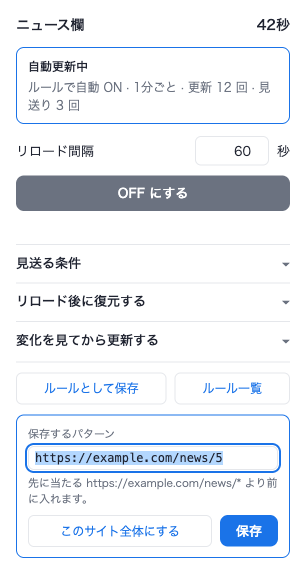

# Smart Reload

ページを自動でリロードする Chrome 拡張 (MV3)。

ふつうの自動リロードと違って、**読んでいる最中だと分かったら、その回は黙って見送ります**。
リロードしたあとはスクロール位置と入力内容を元に戻し、ページの中身が変わっていないときは
そもそも読み込み直しません。


## できること

### 操作中・再生中は自動で見送る

次のどれかに当てはまる間はリロードせず、数秒後に改めて試します。条件は個別に切れます。

| 条件 | 判定 |
| --- | --- |
| 入力中 | 入力欄・`contenteditable` に文字が入っていて、そこにカーソルがある |
| テキスト選択中 | 範囲選択されている |
| 動画・音声の再生中 | 再生中のメディアがある (ミュートされているものは数えない) |
| 直前に操作した | 最後のキー入力・クリック・ホイール操作から既定 5 秒以内 |

読んでいる途中で画面が飛ぶ、コメントを書いている最中に消える、といった
自動リロードのいちばん困るところを潰すための機能です。

### スクロール位置とフォームの入力内容を復元する

リロードの直前に現在位置と入力途中の値を退避し、読み込み直したあとに戻します。
遅延読み込みでページが伸びることを見越して数回に分けて位置を合わせにいきますが、
その間にスクロールしたら引き戻しません。

**パスワード欄・ファイル選択・`hidden` は保存しません。** 退避先はそのタブの
`sessionStorage` なので、タブを閉じれば消えます。

### 変化したときだけリロードする

裏でページを取り直し、前回取ったものと中身を比べます。変わっていなければ読み込み直しません。
画面が無駄にちらつかず、通信も減ります。変化したときに通知を出すこともできます。

監視する範囲は CSS セレクタで絞れます (例: `#main`)。空欄ならページ全体です。

### ページが切り替わったら自分から降りる

ON のまま**同じタブの中で別のページへ移ったら、その時点で OFF になります**。
YouTube の配信待機ページのように、リンクを踏まなくても URL だけが差し替わる作りの
サイトでも、移った先でリロードが走ることはありません。

ルールで ON になっていた場合は、移った先の URL でルールを引き直します。当たるルールが
あればその設定で続き、無ければ止まります。

ページ内リンク (`#` から後ろだけの変化) は移動に数えないので、途中で止まりません。

### URL パターンで自動 ON

設定画面にルールを登録しておくと、当てはまるページを開いた瞬間に自動で ON になります。
ルールは上から順に照合し、**最初に当たった 1 件だけ**が使われます。2 件目以降は見ません。

登録の既定は**そのページのフルパス**なので、同じサイトでもページごとに別の設定を持てます。
サイト全体に効かせたいときは `*` を使います。

```
https://example.com/news/1   そのページだけ (「ルールとして保存」の既定)
https://example.com/*        example.com のすべてのページ
https://*.example.com/*      サブドメインをまとめて
example.com/news             URL に example.com/news を含むページ
```

パターンはワイルドカード `*` のみで、正規表現は使えません。`://` を含まない書き方は
部分一致として扱います。

> 上から順に 1 件だけという性質上、広いルールを上に置くと、その下の具体的なルールは
> 永久に発火しません。ポップアップから保存する場合は**自動的に必要な位置へ差し込まれます**が、
> ルール一覧で手を入れるときは**具体的なものを上に**並べてください。

並び順は、ルール一覧で左端の `⠿` をつかんでドラッグすると変えられます。


## インストール

1. このリポジトリを clone する
2. `chrome://extensions` を開き、右上の「デベロッパーモード」を ON にする
3. 「パッケージ化されていない拡張機能を読み込む」でこのディレクトリを選ぶ

ショートカットキーは既定では割り当てていません。必要なら
`chrome://extensions/shortcuts` で「このタブの自動リロードを切り替える」に好きなキーを設定してください。

## 使い方

ツールバーのアイコンからポップアップを開き、間隔を入れて **ON にする**。
ルールで自動 ON になっているページでは、ポップアップの左上に**そのルールの名前**が出ます
(名前が空ならパターンがそのまま出ます)。名前は **ルール一覧** で付けられます。

アイコンが青くなり、バッジが点きます。**動作中はバッジの色が濃い青と淡い青のあいだで
1 秒ごとに明滅する**ので、ポップアップを開かなくても動いていることが分かります。

残り 30 秒を切るとバッジが秒数のカウントダウンに変わり、**数字を読みやすくするため
明滅は止まります**。見送っている間はグレーで止まります。理由はアイコンにマウスを
乗せたときのツールチップと、ポップアップに出ます。

| バッジ | 意味 |
| --- | --- |
| 濃青 ⇄ 淡青（明滅） | 動作中 |
| 濃青のまま + 秒数 | もうすぐ更新（残り 30 秒以内） |
| グレーのまま | 操作中などで見送り中 |
| 消えている | OFF |

> 明滅するのは**そのタブを見ている間だけ**です。裏に回ると止まります
> (裏のタブのバッジはそもそも表示されないうえ、動かし続けると拡張の
> service worker が起きっぱなしになるため)。

> バッジもアイコンもアクティブなタブの分しか表示されません。裏で動いているタブの状態は、
> そのタブに切り替えるまで見えません。

いつも同じ設定で使いたくなったら **ルールとして保存** を押します。保存するパターンが
出るので、確認してから保存してください。

- 初期値は**そのページのフルパス**（クエリは残り、`#` 以降は落とします）
- **このサイト全体にする** を押すと `https://ホスト名/*` に広がります
- 手で好きなパターンに書き換えても構いません

既に同じパターンのルールがあれば上書き更新になり、別のルールが先にこのページへ当たる場合は
その旨が出たうえで、**そのルールより前に差し込まれます**（後ろに置くと発火しないため）。



設定を触ったときの保存先は状況で変わります。

- OFF のとき → 次に ON にするときの既定値として保存される
- ON のとき → そのタブに即時反映される (ルールそのものは書き換わらない)

## 制限

- **SPA では変化検知が効きません。** 取り直した HTML と、画面に出ている内容が別物になるためです。
  サーバが HTML を返す種類のページで使ってください。
- 移動の検知は 1 秒ごとの見回りなので、「移った先でリロードしない」は保証されますが、
  ポップアップの表示が OFF に変わるまで最大 1 秒かかります。
- クロスオリジンの iframe の中は覗けないので、埋め込み動画の再生は検知できません。
- フォームの復元は `input` / `textarea` / `select` が対象です。リッチエディタなど
  独自に状態を持つものは戻せないことがあります。
- 5 分以上の間隔をバックグラウンドタブで使うと、ブラウザのタイマー制限で最大 1 分ほど遅れて
  発火することがあります (5 分未満なら影響を受けません)。

## 開発

拡張自体はビルド不要のプレーン JS です。テストだけ Playwright を使います。

```sh
PLAYWRIGHT_SKIP_BROWSER_DOWNLOAD=1 npm install   # ブラウザ本体は Brave Nightly を使うので落とさない
npm test             # 実ブラウザで E2E を通す (リロード動作 + 設定画面)
```

アイコンを変えたら `icons/build.sh` で PNG を書き出し直してください。

実装の詳細・設計判断は `.claude/skills/smart-reload/SKILL.md` にあります。
