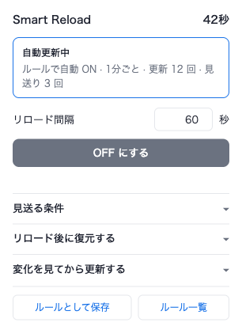
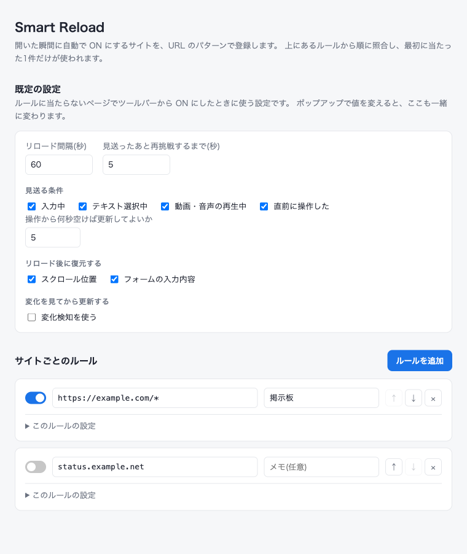

# Smart Reload

ページを自動でリロードする Chrome 拡張 (MV3)。

ふつうの自動リロードと違って、**読んでいる最中だと分かったら、その回は黙って見送ります**。
リロードしたあとはスクロール位置と入力内容を元に戻し、ページの中身が変わっていないときは
そもそも読み込み直しません。



## できること

### 操作中・再生中は自動で見送る

次のどれかに当てはまる間はリロードせず、数秒後に改めて試します。条件は個別に切れます。

| 条件 | 判定 |
| --- | --- |
| 入力中 | 入力欄・`contenteditable` に文字が入っていて、そこにカーソルがある |
| テキスト選択中 | 範囲選択されている |
| 動画・音声の再生中 | 再生中のメディアがある (ミュートされているものは数えない) |
| 直前に操作した | 最後のキー入力・クリック・ホイール操作から既定 5 秒以内 |

読んでいる途中で画面が飛ぶ、コメントを書いている最中に消える、といった
自動リロードのいちばん困るところを潰すための機能です。

### スクロール位置とフォームの入力内容を復元する

リロードの直前に現在位置と入力途中の値を退避し、読み込み直したあとに戻します。
遅延読み込みでページが伸びることを見越して数回に分けて位置を合わせにいきますが、
その間にスクロールしたら引き戻しません。

**パスワード欄・ファイル選択・`hidden` は保存しません。** 退避先はそのタブの
`sessionStorage` なので、タブを閉じれば消えます。

### 変化したときだけリロードする

裏でページを取り直し、前回取ったものと中身を比べます。変わっていなければ読み込み直しません。
画面が無駄にちらつかず、通信も減ります。変化したときに通知を出すこともできます。

監視する範囲は CSS セレクタで絞れます (例: `#main`)。空欄ならページ全体です。

### URL パターンで自動 ON

設定画面にルールを登録しておくと、当てはまるページを開いた瞬間に自動で ON になります。
ルールは上から順に照合し、**最初に当たった 1 件だけ**が使われます。

パターンはワイルドカード `*` のみ。`://` を含まない書き方は部分一致として扱います。

```
https://example.com/*      example.com のすべてのページ
example.com/news           URL に example.com/news を含むページ
https://*.example.com/*    サブドメインをまとめて
```



## インストール

1. このリポジトリを clone する
2. `chrome://extensions` を開き、右上の「デベロッパーモード」を ON にする
3. 「パッケージ化されていない拡張機能を読み込む」でこのディレクトリを選ぶ

ショートカットキーは既定では割り当てていません。必要なら
`chrome://extensions/shortcuts` で「このタブの自動リロードを切り替える」に好きなキーを設定してください。

## 使い方

ツールバーのアイコンからポップアップを開き、間隔を入れて **ON にする**。
アイコンが青くなり、残り 10 秒を切るとバッジに秒数が出ます。見送っている間はバッジが消え、
ポップアップとツールチップに理由が出ます。

そのサイトをいつも同じ設定で使いたくなったら **ルールとして保存** を押します。
`https://ホスト名/*` のルールができるので、細かいパターンは **ルール一覧** から直してください。

設定を触ったときの保存先は状況で変わります。

- OFF のとき → 次に ON にするときの既定値として保存される
- ON のとき → そのタブに即時反映される (ルールそのものは書き換わらない)

## 制限

- **SPA では変化検知が効きません。** 取り直した HTML と、画面に出ている内容が別物になるためです。
  サーバが HTML を返す種類のページで使ってください。
- クロスオリジンの iframe の中は覗けないので、埋め込み動画の再生は検知できません。
- フォームの復元は `input` / `textarea` / `select` が対象です。リッチエディタなど
  独自に状態を持つものは戻せないことがあります。
- 5 分以上の間隔をバックグラウンドタブで使うと、ブラウザのタイマー制限で最大 1 分ほど遅れて
  発火することがあります (5 分未満なら影響を受けません)。

## 開発

拡張自体はビルド不要のプレーン JS です。テストだけ Playwright を使います。

```sh
PLAYWRIGHT_SKIP_BROWSER_DOWNLOAD=1 npm install   # ブラウザ本体は Brave Nightly を使うので落とさない
npm test             # 実ブラウザで E2E を通す (リロード動作 + 設定画面)
```

アイコンを変えたら `icons/build.sh` で PNG を書き出し直してください。

実装の詳細・設計判断は `.claude/skills/smart-reload/SKILL.md` にあります。
